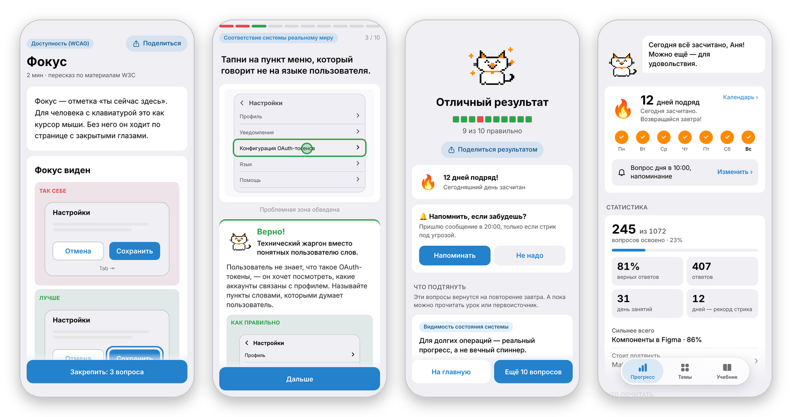

  

<h1 align="center">UX-тренажёр</h1>

  Telegram Mini App, который учит основам UX/UI и Figma, 
  а тесты не дают знаниям вылететь из головы.

  <a href="https://t.me/uxuitrainer_bot?startapp=github"><b>Открыть в Telegram →</b></a>
  &nbsp;·&nbsp; бесплатно &nbsp;·&nbsp; без рекламы &nbsp;·&nbsp; ничего не нужно скачивать

  

  Урок из учебника · задание на макете · итоги сессии · прогресс и стрик

## Как это работает

| 📖 Учись | 🎯 Закрепляй | 🔁 Повторяй |
|---|---|---|
| **122 урока** простым языком: пересказ NN/g, Laws of UX, Apple, Google, W3C и справки Figma с примерами из жизни и макетами «так себе / лучше». | **Больше 1000 вопросов**, многие на макетах. После каждого ответа есть разбор и ссылка на первоисточник, а после ошибки можно сразу открыть урок. | Ошибки возвращаются через **1, 3 и 7 дней**. За ежедневные занятия растёт стрик, а кот Кегль присматривает за прогрессом. |

## Что внутри

**14 тем в трёх разделах:**

- **UX/UI:** эвристики Нильсена, законы UX, UX-райтинг, юзабилити-тестирование, визуальный дизайн.
- **Гайдлайны:** Apple HIG, Material Design 3, доступность (WCAG 2.2).
- **Figma:** компоненты, свойства и варианты, автолейаут, переменные, прототипирование, дизайн-системы.

**Возможности:**

- **Учебник для новичков.** Урок по каждой теме, в конце три вопроса на закрепление, а дальше следующий урок по порядку.
- **Задания на макетах.** Тапни на проблему, найди все ошибки на экране, выбери лучший вариант, расставь шаги по порядку, отметь все верные ответы.
- **Разбор каждого ответа.** Короткая суть, объяснение, пример «как правильно» и ссылка на первоисточник.
- **Повторение и стрик.** Вопросы, в которых ты ошибся, возвращаются по интервалам. Календарь показывает все дни занятий.
- **Поделиться.** Результат теста, стрик или урок уходит в чат карточкой с твоими цифрами и кнопкой, которая открывает тренажёр.
- **Вопрос дня и напоминания.** По желанию бот пришлёт вопрос в удобное время и напомнит, если стрик под угрозой. Настраивается в приложении или командой `/settings`.

## Обратная связь

Проект некоммерческий и делается для дизайн-сообщества. Нашли неточность в вопросе или уроке или хотите предложить свой вопрос — [создайте issue](https://github.com/cybertatar/uxuieducationminiapp/issues).

Автор — [Daniil Tyncherov](https://t.me/everlastinghate). Тренажёр бесплатный и без рекламы. Если он помогает, автора можно поблагодарить звёздами Telegram: ссылка «Поддержать проект» есть внизу главной.
